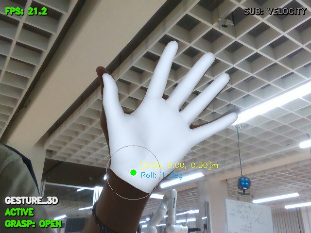
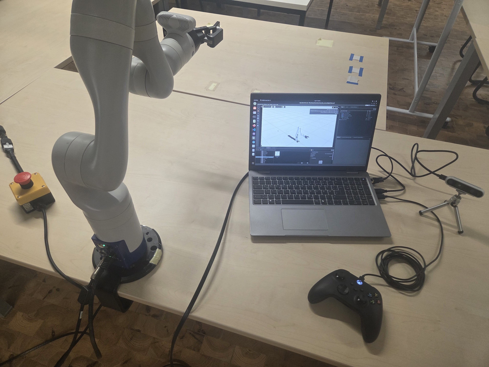

## Hi, I'm Nico 👋

I'm an M.Sc. student in Mechatronics & Robotics and a student research assistant at **Frankfurt University of Applied Sciences**, working in the group of Prof. Dr.-Ing. Eric Guiffo Kaigom.

I work on making robots easier to control for the people who use them, with a focus on **human-robot interaction and teleoperation for on-orbit satellite servicing**.

  
  &nbsp;
  

### 🔭 What I'm working on

- **Hybrid teleoperation** of a 7-DOF Kinova Gen3 arm via joystick, 2D/3D hand-gesture tracking and an NVIDIA Isaac Sim digital twin (my bachelor's thesis) → [showcase](https://github.com/nicolasmahr/hybrid-teleoperation-showcase)
- A **modular ROS 2 plugin platform** that unifies teleoperation, learning-based motion planning and smart grasping
- An **iSAIRAS** paper (lead author) on task-grounded, memory-augmented human-robot interaction for satellite servicing

### 🛠️ Tools & technologies

**Robotics:** ROS 2 · Pinocchio · NVIDIA Isaac Sim · RoboDK · KUKA KRL

**Vision:** MediaPipe · HaMeR · Intel RealSense

**Languages:** Python · C++ · C · MATLAB/Simulink

**Automation:** TwinCAT 3 · Siemens TIA Portal

### 📫 Connect

[LinkedIn](https://www.linkedin.com/in/nicolas-mahr-062458281/)

Most of my research code lives in private repositories. Feel free to reach out if you'd like to know more.
